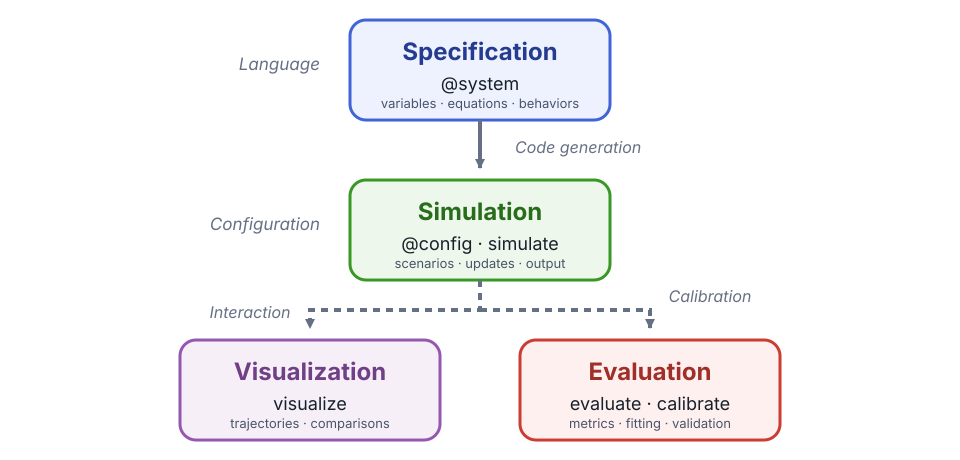

# [How Cropbox Works](@id cropbox-concepts)

The [Quick Start](@ref quick-start) runs a small logistic growth model. This page
explains its declarations and introduces two more behaviors, without changing
the growth equation.

## Read a declaration

```julia
W(W, r, Wf): biomass => r * W * (1 - W / Wf) ~ accumulate(init = W0, u"g")
```

Read this from left to right:

- `W` is the short variable name; `biomass` is its descriptive alias.
- `(W, r, Wf)` lists the values used in the equation.
- The expression after `=>` calculates a rate of change.
- `accumulate`, after `~`, integrates that rate over time.
- The tags `init = W0` and `u"g"` set the initial value and stored unit.

The dependency on `W` itself is intentional: growth depends on the current
biomass. An accumulated state carries its value from one time step to the
next. This differs from a circular set of algebraic equations that has no
starting value.

## Four common behaviors

A behavior describes how a variable gets its value. Most first models can be
read using these four:

| Behavior | Meaning | Growth example |
|---|---|---|
| `preserve` | Initialize a value and keep it. | The parameter `r`. |
| `track` | Recalculate a value from its dependencies. | The current growth rate `g`. |
| `accumulate` | Integrate a rate over time. | Biomass `W`. |
| `flag` | Store whether a condition is true. | Whether biomass has reached a chosen threshold. |

We can name the rate separately and add a stopping condition:

```@example concepts
using Cropbox

@system LogisticGrowth(Controller) begin
    r: growth_rate      => 0.05                 ~ preserve(parameter, u"d^-1")
    Wf: final_biomass   => 300                  ~ preserve(parameter, u"g")
    W0: initial_biomass => 0.25                 ~ preserve(parameter, u"g")

    g(W, r, Wf): growth => r * W * (1 - W / Wf) ~ track(u"g/d")
    W(g): biomass                               ~ accumulate(init = W0, u"g")

    ready(W, Wf)        => W >= 0.9Wf           ~ flag
end
nothing # hide
```

`g` and `W` now expose the rate and the accumulated state separately.
`ready` becomes true when biomass reaches 90% of `Wf`; this is a numerical
threshold for the example, not a biological definition of maturity.

A tag modifies a behavior. Here `parameter` makes a preserved value
configurable, `init` supplies the initial biomass, and unit tags declare
dimensions. Additional behaviors and the complete tag rules belong in
[Behaviors and Tags](@ref behaviors-and-tags).

## Systems and dependencies

A system groups declarations into a reusable model component. The names in
parentheses identify dependencies, so Cropbox can update a derived value after
the values it needs. You do not have to write the update routine yourself.

Components can be combined with mixins or kept separate as child systems.
`Controller` supplies a shared `Context` containing configuration and the
clock. This lets components use the same scenario and model time. The next
page, [Systems and Composition](@ref system), explains those two ways to
combine systems.

## Modeling workflow

The same three stages apply to a small example and a whole-crop model:



### Specify the model

Declare variables, dependencies, equations, behaviors, and units with
`@system`. The declaration defines a reusable model type; it does not run a
simulation.

### Configure and simulate

Apply a scenario without changing the equations:

```@example concepts
config = @config (
    LogisticGrowth => :r => 0.07,
    Clock => :step => 1u"d",
)
```

The plain value `0.07` acquires the unit declared by `r`. Using the system
type as the key also allows parameter names and units to be checked.

```@example concepts
result = simulate(LogisticGrowth;
    config,
    stop = :ready,
    target = [:W, :g, :ready],
)
last(result, 3)
```

Each call to `simulate` starts a fresh model. Here `stop = :ready` checks
the model's own condition. [Model Execution](@ref model-execution) explains
instances, time steps, stopping, and saved output.

### Visualize and evaluate

The Quick Start plots biomass over time. Keeping `g` in the output also lets
us ask a different question: at which biomass is growth fastest?

```@example concepts
visualize(result, :W, :g;
    kind = :line,
    xlab = "Biomass",
    ylab = "Growth rate",
    legend = false,
)
```

The rate rises and then falls as `W` approaches `Wf`. This curve is read
against biomass, not time.

When observations are available, `evaluate` compares them with model
estimates and `calibrate` searches parameter ranges. Follow
[Evaluate and Calibrate Models](@ref evaluation-tutorial) when you reach that
stage; neither is needed to understand the declarations above.

## Continue learning

Continue with [Systems and Composition](@ref system), then
[Model Execution](@ref model-execution). Use [DSL Syntax](@ref dsl-syntax)
when you need a particular grammar form, rather than reading the full reference
before the next example.
