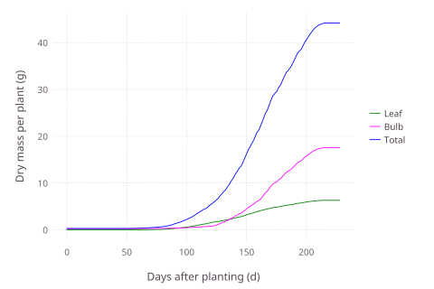
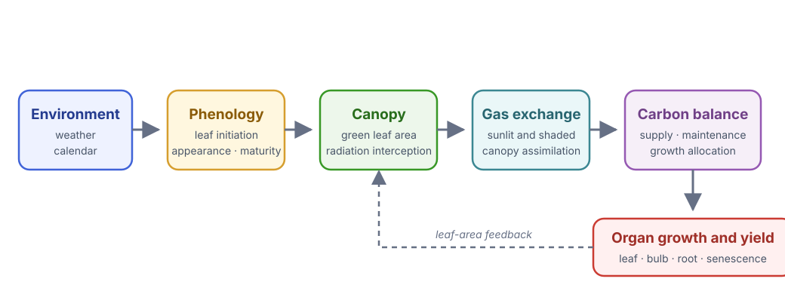
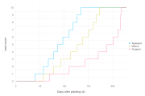
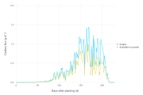
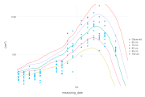
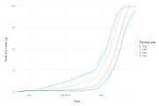

# [Garlic Growth Model](@id garlic-tutorial)

How does a garlic plant's dry mass change in the leaves and the bulb over a season?
Run a season of [Garlic.jl](https://github.com/cropbox/Garlic.jl) with its
packaged weather and cultivar settings, then read the two curves. No model
declarations or separate weather file are needed.

The model combines the [leaf development and expansion study (*Annals of
Botany*, 2019)](https://doi.org/10.1093/aob/mcz060) with the
[whole-plant biomass and yield study (*Frontiers in Plant Science*,
2022)](https://doi.org/10.3389/fpls.2022.783810).

## Run a garlic season

Install the two packages in your Julia environment:

```julia
using Pkg
Pkg.add(["Cropbox", "Garlic"])
```

The example below is a **Korean Mountain** hardneck garlic planting in Seattle.
The configuration supplied by Garlic already contains the cultivar, weather,
and calendar. Run the following blocks in order in one session:

```julia
using Cropbox, Garlic
import Dates

config = Garlic.Examples.AoB.KM_2014_P2_SR0
result = simulate(Garlic.Model;
    config,
    stop = "calendar.count",
    snap = s -> Dates.hour(s.calendar.time') == 12,
);
```

The model updates hourly through the end of its calendar. The `snap` function
reads the local time with `s.calendar.time'` and saves a row at noon each day;
it does not change the model's time step.
The semicolon keeps Julia from printing the whole table.

## Read leaf and bulb mass

Plot three columns of the saved result against `DAP` (days after planting):

```julia
visualize(result, :DAP, [:leaf_mass, :bulb_mass, :total_mass];
    kind = :line,
    names = ["Leaf", "Bulb", "Total"],
    colors = [:green, :magenta, :blue],
    xlab = "Days after planting",
    ylab = "Dry mass per plant",
)
```



Around day 125 the leaves are heavier than the bulb. By the last day (228
days after planting), the bulb has about 17.6 g of dry mass per plant and
the leaves 6.3 g. The total includes other organs too. These are simulated
masses from the packaged scenario, not harvest measurements.

To read the last saved day as numbers, use
`result[end, [:DAP, :leaf_mass, :bulb_mass, :total_mass]]`. You can stop here
after your first run. If you inspect the first rows instead, you will see
`DAP = 0` more than once: the weather calendar begins before planting.

## What drives the curves?

The leaf and carbon plots below reuse the same `result`. To see which systems
and parameters produced it, inspect the model type:

```julia
look(Garlic.Model)
parameters(Garlic.Model; alias = true)
parameters(Garlic.Model;
    alias = true,
    recursive = true,
    exclude = (Context,),
)
```

The recursive parameter list is intentionally large. A whole-plant model is
easier to understand component by component. Useful starting systems include
`Garlic.Phenology`, `Garlic.Photosynthesis`, `Garlic.Weight`, and `Garlic.Water`.

Keep this process chain in mind while reading the output:

| Stage | Useful outputs | Question answered |
|---|---|---|
| calendar and phenology | `time`, `DAP`, leaf counts | Is the plant in the expected stage? |
| canopy development | `green_leaf_area`, `LAI` | How much active leaf area intercepts light? |
| assimilation and carbon | `A_gross`, `carbon_supply`, `total_carbon` | How much carbon is available for growth? |
| allocation and survival | organ masses, dropped area | Where did that carbon go, and how much tissue remains alive? |



*The model proceeds from environment and phenology to canopy gas exchange and
carbon allocation and organ growth.*

The dry-mass curves above emerge from these processes; they are not fitted
directly to time.

In the current implementation, leaf phenology and expansion determine
`green_leaf_area`, which controls `LAI`, radiation interception, and carbon
supply. Accumulated leaf mass does not feed back to leaf area through a
specific-leaf-area equation: the leaf-level `carbon_effect` is fixed at `1.0`.
`SLA` is calculated as a diagnostic, and a fixed SLA value is used when
estimating potential leaf carbon demand. The process diagram therefore shows
the implemented forward path rather than a general SLA-based crop-model
feedback.

## Follow leaf development

```julia
visualize(result,
    :DAP,
    [:leaves_appeared, :leaves_mature, :leaves_dropped];
    names = ["Appeared", "Mature", "Dropped"],
    kind = :step,
)
```



*Initiated leaves appear, mature, and eventually drop in a biologically ordered
sequence. Step geometry preserves the count-variable interpretation.*

A step plot matches count variables better than an interpolated line. Plot
initiated and appeared leaves together when diagnosing phenology.

```julia
visualize(result,
    :DAP,
    [:leaves_initiated, :leaves_appeared];
    kind = :step,
)
```

`leaves_initiated` counts primordia already formed at the apex;
`leaves_appeared` counts leaves visible above the soil or sheath. Mature and
dropped counts describe later states of those leaves. Their ordering provides
a quick consistency check even before leaf area is plotted.

## Leaf area and biomass

```julia
visualize(result, :DAP, :green_leaf_area; kind = :line)
```

Compare green leaf area with the [leaf and bulb dry masses](#Read-leaf-and-bulb-mass)
from the same run. Green leaf area determines how much radiation the plant
can intercept. Biomass partitioning depends on developmental stage; more leaf
mass does not directly produce more area through a fixed specific leaf area.

## Trace the carbon path

The workshop follows gross canopy photosynthesis through carbon supply to the
carbon available for organ growth. These variables have different units, so
plot them separately rather than forcing them onto one axis.

```julia
visualize(result, :DAP, :A_gross; kind = :line)

visualize(result,
    :DAP,
    [:carbon_supply, :total_carbon];
    names = ["Supply", "Available for growth"],
    kind = :line,
)

visualize(result,
    :DAP,
    :(total_carbon / total_mass);
    ylab = "Relative growth rate",
    kind = :line,
)
```



*Daily carbon supply and carbon available for growth. Weather-driven variation
is retained rather than smoothed away.*

`A_gross` is a canopy flux. `carbon_supply` converts assimilated carbon to the
plant basis and releases it from the carbon pool; `total_carbon` also reflects
maintenance and growth conversion before partitioning. The derived ratio is a
diagnostic, not a separately fitted model parameter. A strange final mass can
therefore be traced upstream instead of corrected immediately with an
allocation parameter.

## Compare observations across parameter values

The workshop overlays measured leaf area with several values of `LM_min`, the
minimum length of the model's longest leaf. This combines an observation plot
and grouped model runs without changing the packaged base configuration.
Only this comparison needs the additional table-reading packages:

```julia
using Pkg
Pkg.add(["CSV", "DataFrames"])
```

```julia
using CSV
using DataFrames

observed = CSV.read(
    Garlic.datapath("Korea/ricca_2014_field.csv"),
    DataFrame,
) |> unitfy

p = visualize(observed, :measuring_date, :leaf_area;
    name = "Observed",
    kind = :scatter,
)

visualize!(p, Garlic.Model, :time, :green_leaf_area;
    config = Garlic.Examples.RCP.ND_RICCA_2014_field,
    stop = "calendar.count",
    snap = 1u"d",
    group = Garlic.Leaf => :LM_min => [60, 70, 80, 90, 100],
    legend = "LM_min",
    kind = :line,
)
```



*Observed leaf area overlaid with simulations across `LM_min` values. The plot shows
whether the parameter moves the trajectory as expected; it is not by itself a
calibration result.*

Treat this first as a sensitivity check: does the parameter move the output in
the expected direction and period? Selecting the visually closest line is not
calibration. Formal fitting also needs a stated metric, defensible bounds, and
independent validation; see [Evaluate and Calibrate Models](@ref
evaluation-tutorial).

## Compare planting dates

The 2025 workshop varies one parameter while retaining a packaged regional
configuration. The pattern is:

```julia
base = Garlic.Examples.RCP.ND_RICCA_2014_field
planting_dates = [
    ZonedDateTime(2014,  9, 1, tz"Asia/Seoul"),
    ZonedDateTime(2014, 10, 1, tz"Asia/Seoul"),
    ZonedDateTime(2014, 11, 1, tz"Asia/Seoul"),
    ZonedDateTime(2014, 12, 1, tz"Asia/Seoul"),
]

visualize(Garlic.Model, :time, :bulb_mass;
    config = (
        base,
        Calendar => :init => ZonedDateTime(2014, 9, 1, tz"Asia/Seoul"),
    ),
    stop = "calendar.count",
    snap = 1u"d",
    group = Garlic.Phenology => :planting_date => planting_dates,
    legend = "Planting date",
    names = ["Sep", "Oct", "Nov", "Dec"],
    kind = :line,
)
```



*Changing planting date shifts the timing of bulb growth under the shared
weather record. Comparing final values alone would hide most of this response.*

For a scientific comparison, ensure every planting date has sufficient weather
coverage and use the same cultivar, site, soil, and harvest rule.

## Collect organ-level output

Dynamic nodal units and leaves are not ordinary scalar columns. `snatch` can add
one column per leaf rank at snapshot time:

```julia
ranked = simulate(Garlic.Model;
    config,
    index = :time,
    target = [],
    stop = "calendar.count",
    snap = 1u"d",
    snatch = (rows, s) -> begin
        for nu in s.NU
            rows[end][Symbol(nu.rank')] = nu.leaf.green_area'
        end
    end,
)
```

This is intentionally advanced. The set of columns can change as organs are
produced, so downstream code must handle missing ranks. Prefer aggregate outputs
for routine calibration and reserve organ-level extraction for morphology
questions. The general `snatch` lifecycle and output rules are documented in
[Simulation](@ref Simulation1).

## A diagnostic order for whole-plant results

When yield or bulb mass looks wrong, inspect processes upstream in this order:

1. calendar, weather coverage, and planting date;
2. development phase and leaf initiation/appearance;
3. green leaf area and `LAI`;
4. sunlit/shaded irradiance and gas exchange;
5. carbon supply and growth rate;
6. organ partitioning, senescence, and final mass.

Changing a final partition parameter before checking upstream limitations can
fit one output while making the internal model inconsistent.

For plotting variants used above—including grouped systems, observation
overlays, and expression targets—see [Visualization](@ref Visualization1).
