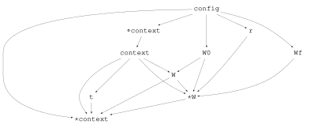

# [Logistic Growth](@id logistic-growth-tutorial)

This tutorial translates a logistic growth equation into a Cropbox
specification, configures a scenario, runs the model, and examines the result.
It develops the model introduced in the [Quick Start](@ref quick-start).
The next tutorial adds [weather-driven phenology](@ref phenology-tutorial).

Before starting, add the packages used below to your active Julia environment:

```julia
using Pkg
Pkg.add(["Cropbox", "DataFrames"])
```

Run the code blocks in order in the same Julia session.

## Start from the process equation

Let whole-plant biomass ``W`` follow logistic growth:

```math
\frac{dW}{dt} = rW\left(1 - \frac{W}{W_f}\right),
\qquad W(0) = W_0.
```

Before writing code, identify the role and behavior of every symbol.

| Symbol | Meaning | Cropbox role |
|---|---|---|
| ``r`` | relative growth rate | configurable value preserved during a run |
| ``W_f`` | potential final biomass | configurable value preserved during a run |
| ``W_0`` | initial biomass | configurable initial value |
| ``W`` | current biomass | state accumulated from its growth rate |

This semantic inventory is the bridge between an equation and the model DSL.

## Specify the model

```@example logistic
using Cropbox
using DataFrames

@system LogisticGrowth(Controller) begin
    r: growth_rate       => 0.05                 ~ preserve(parameter, u"d^-1")
    Wf: final_biomass    => 300                  ~ preserve(parameter, u"g")
    W0: initial_biomass  => 0.25                 ~ preserve(parameter, u"g")
    W(W, r, Wf): biomass => r * W * (1 - W / Wf) ~ accumulate(init = W0, u"g")

    t(context.clock.time): time                  ~ track(u"d")
end
```

The growth equation is the same as in the Quick Start. This version adds `t`
to expose time in days as a named output. For a walkthrough of the declaration
syntax, see [How Cropbox Works](@ref cropbox-concepts).

## Inspect the specification

Check the configurable surface before building a scenario.

```@example logistic
parameters(LogisticGrowth)
```

Use `look` for the complete declaration or one variable.

```@example logistic
look(LogisticGrowth, :W)
```

## Configure a scenario

Defaults make the model runnable, but an external configuration keeps the
scientific specification separate from a particular experiment.

```@example logistic
config = @config Clock => :step => 1u"d"
```

The model parameters keep their declared defaults. This configuration changes
only the clock step. System type keys allow Cropbox to validate parameter names
and units when you change model parameters in a later scenario.

## Run the simulation

Request an explicit index and target so the output contract is clear.

```@example logistic
result = simulate(LogisticGrowth;
    config,
    stop = 300u"d",
    index = :t,
    target = :W,
)

first(result, 5)
```

The model updates at `Clock.step`. The returned DataFrame includes the initial
state and subsequent daily snapshots through the stop time.

## Compare with observations

Evaluation uses the same specification and configuration. These illustrative
values stand in for measured biomass; they are not experimental observations.

```@example logistic
observations = DataFrame(
    t = [0, 100, 200, 300]u"d",
    W = [0.25, 33, 284, 300]u"g",
)

visualize(observations, LogisticGrowth, :t, :W;
    config,
    stop = 300u"d",
    name = "illustrative data",
    names = ["model"],
    xlab = "Time",
    ylab = "Biomass",
)
```

The points show the supplied data and the line shows the simulated trajectory.
Use the same time index and biomass variable to calculate the root mean squared
error (RMSE):

```@example logistic
evaluate(LogisticGrowth, observations;
    config,
    index = :t,
    target = :W,
    stop = 300u"d",
    metric = :rmse,
)
```

`calibrate` extends this step by searching bounded parameter ranges. Keep the
data used for calibration separate from independent validation data; see
[Evaluate and Calibrate Models](@ref evaluation-tutorial) for the full workflow.

## Optional: inspect the dependency graph

The graph below exposes scheduling details. It is useful for investigating
dependencies, but reading its generated stages is not a prerequisite for
building the model above. [Inspection](@ref Inspection1) and
[Inspect and Visualize Models](@ref inspection-workflow) provide the related
lookup tools.

```@raw html
<details><summary>Show the generated dependency graph</summary>
```

`Cropbox.dependency` exposes the graph Cropbox uses to order declarations and
update stages:

```@example logistic
d = Cropbox.dependency(LogisticGrowth)
println(repr(MIME("text/plain"), d))
nothing # hide
```

The text form gives the generated update order. The SVG below is written
directly from the same graph object:

```julia
Cropbox.writeimage("logistic-dependency", d; format = :svg)
```



*Direct `writeimage` output from `dependency(LogisticGrowth)`. Generated stages
such as `∘context`, `⋆context`, and `⋆W` remain visible because this is the
actual scheduling graph rather than a redrawn scientific summary.*

```@raw html
</details>
```

## Continue

Next, follow [Weather-driven Phenology](@ref phenology-tutorial) to add calendar
time and weather input. For questions about this example:

- [DSL Syntax](@ref dsl-syntax) explains every declaration component.
- [Configure Models and Scenarios](@ref configuration-workflow) covers merging
  configurations and parameter comparisons.
- [Run Simulations and Shape Output](@ref simulation-workflow) covers stopping,
  snapshots, and output selectors.
